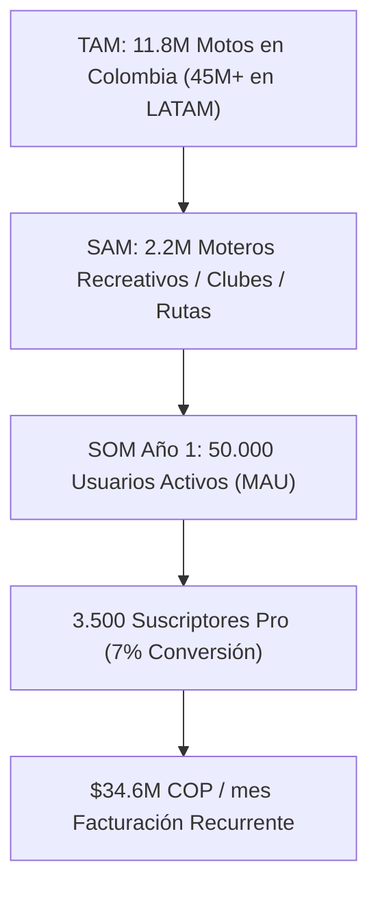
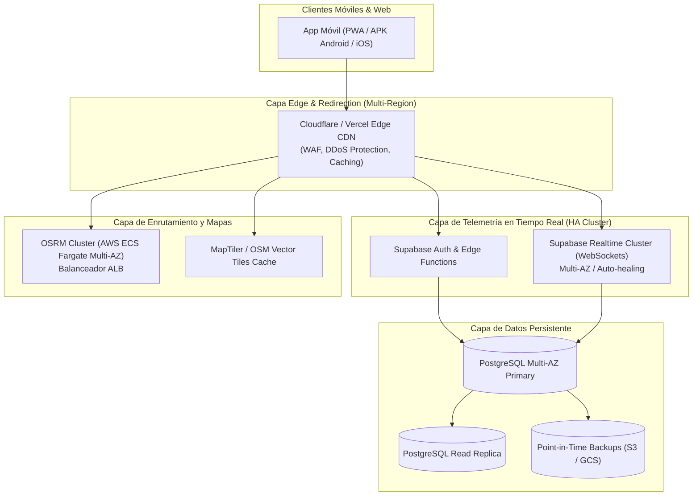

# 📊 Estudio Exhaustivo de Viabilidad Financiera, Pricing, Alta Disponibilidad (HA) y Escalabilidad — Bike Tracker

---

## 1. Resumen Ejecutivo y Tesis de Negocio

**Bike Tracker** tiene el potencial de convertirse en la plataforma de telemetría, seguridad y navegación grupal líder para motociclistas en Colombia y Latinoamérica.

Para garantizar que la aplicación sea **altamente rentable**, **accesible para cualquier motero** y capaz de sostener una infraestructura de **Alta Disponibilidad (HA - 99.9% Uptime)** con operación delegada, se establece un modelo **Freemium con micro-transacciones y suscripciones recurrentes**.

### 🎯 Parámetros Clave del Modelo Recomendado
- **Precio Mensual Pro Recomendado:** **$9.900 COP / mes (~$2.49 USD / mes)**  
  *(Costo psicológico menor a 1 galón de gasolina corriente o un café en carretera).*
- **Precio Anual Pro Recomendado:** **$79.900 COP / año (~$19.99 USD / año)**  
  *(Descuento del 33%, equivalente a $6.650 COP/mes, asegurando flujo de caja inicial).*
- **Pase Rodada de Fin de Semana (Micro-transacción):** **$3.900 COP (~$0.99 USD por 72 horas)**.
- **Plan Biker Club (B2B2C para Clubes y Organizadores):** **$39.900 COP / mes (~$9.99 USD / mes)** *(Hasta 25 pilotos en convoy bajo la cuenta del club)*.
- **Margen Operativo Bruto Estimado:** **82% - 88%**.
- **Punto de Equilibrio (Break-Even):** **380 suscriptores Pro activos** cubren el 100% de la infraestructura cloud redundante en HA.
- **Capacidad de Delegación Operativa:** A partir de **2.500 suscriptores Pro**, el negocio genera flujo suficiente para contratar soporte al cliente 24/7 y guardias DevOps, liberando al Founder para liderar otros proyectos.

---

## 2. Análisis del Mercado Objetivo (TAM / SAM / SOM)

### 🇨🇴 Contexto Colombia
- **Parque de Motocicletas Registradas:** **11.8 millones** (representa el **61.5%** de todos los vehículos del país según RUNT / ANDI).
- **Venta anual de motocicletas:** ~700.000 unidades nuevas al año.
- **Segmento Recreativo / Rutas / Clubes (SAM):** ~**2.2 millones** de moteros que salen de rodada, viajan los fines de semana o pertenecen a clubes moteros (marcas como Yamaha, Bajaj, KTM, Suzuki, BMW, Royal Enfield, Honda, etc.).

---

## 3. Estructura de Planes: Free vs. Convoy Pro

Para maximizar el crecimiento orgánico viral (efecto de red: un motero descarga la app e invita a sus amigos), la versión gratuita debe ser funcional pero incentivar la conversión natural al Plan Pro.

| Característica / Función | 🆓 Plan Piloto Libre (Gratis) | ⚡ Plan Convoy Pro ($9.900 COP / mes) | 🏆 Plan Biker Club ($39.900 COP / mes) |
|---|:---:|:---:|:---:|
| **Pilotos por Convoy** | Máximo **3 pilotos** | **Ilimitados** | **Ilimitados (Hasta 25 miembros)** |
| **GPS & Telemetría en Vivo** | GPS estándar (actualización cada 3s) | **GPS en tiempo real (1s) + Radar** | **GPS tiempo real + Panel Admin Club** |
| **Alertas de Voz & Waze Style** | Básico (Giro a giro texto) | **Voz en Intercomunicador Bluetooth** | **Voz en Intercomunicador Bluetooth** |
| **Botón SOS de Emergencia** | Envía alerta solo al convoy | **Alerta al convoy + SMS/WhatsApp de emergencia** | **Alerta a convoy + Notificación centralizada** |
| **Alertas de Convoy (Gasolina/Reagrupar)** | Solo recibir | **Emitir y recibir con voz** | **Emitir y recibir con voz** |
| **Historial de Rutas & GPX** | Últimas 2 rutas | **Historial ilimitado + Exportación GPX** | **Historial grupal del Club** |
| **Alertas Documentos (SOAT/RTM)** | 1 Vehículo | **Hasta 5 Vehículos con alertas push** | **Gestión de flota del club** |
| **Modo In-Ride / Guantes** | Estándar | **Interfaz de alto contraste táctil** | **Interfaz de alto contraste táctil** |

---

## 4. Arquitectura Cloud en Alta Disponibilidad (HA - 99.9% Uptime)

Para asegurar que la app **nunca se caiga en medio de una rodada de fin de semana**, se diseña una arquitectura desacoplada, multi-zona y con failover automático.

### Componentes de Alta Disponibilidad:
1. **Frontend & CDN:** Vercel Edge Network / Cloudflare con distribución global en más de 280 ciudades (0 latencia en Colombia - nodos en Bogotá y Medellín).
2. **WebSockets & Base de Datos:** Supabase Pro con PostgreSQL Multi-AZ (Amazon AWS us-east-1 o sa-east-1 São Paulo) con réplicas de lectura y recuperación automática ante fallos.
3. **Servidor de Rutas (OSRM):** Dos instancias en AWS ECS Fargate detrás de un Application Load Balancer con auto-escalado si el tráfico de rodadas sube en fines de semana.
4. **Monitoreo & SRE 24/7:** BetterUptime + Sentry con alertas inmediatas a WhatsApp/Telegram en caso de anomalías.

---

## 5. Estructura de Costos Operativos (OpEx) y Escalabilidad por Fases

A continuación se proyectan los costos reales de infraestructura, pasarelas de pago y soporte a medida que escala la cantidad de usuarios activos mensuales (MAU) y suscriptores de pago:

| Concepto / Servicio | Fase 1 (1.000 MAU / 100 Pro) | Fase 2 (10.000 MAU / 1.000 Pro) | Fase 3 (50.000 MAU / 4.000 Pro) | Fase 4 (100.000 MAU / 10.000 Pro) |
|---|:---:|:---:|:---:|:---:|
| **Frontend & Hosting (Vercel Pro / Edge)** | $20 USD | $40 USD | $100 USD | $250 USD |
| **Base de Datos & Realtime (Supabase Pro/HA)** | $25 USD | $50 USD | $180 USD | $450 USD |
| **Servidores de Rutas (AWS ECS OSRM Cluster)** | $35 USD | $90 USD | $280 USD | $650 USD |
| **Map Tiles & Geocoding (Photon/MapTiler)** | $0 USD (Free tier) | $30 USD | $120 USD | $300 USD |
| **Monitoreo, Logs & Dominio (Sentry, Uptime)** | $15 USD | $30 USD | $70 USD | $150 USD |
| **Comisión Pasarela de Pago (Wompi / Apple / Google ~5%-15%)** | $30 USD | $300 USD | $1.200 USD | $3.000 USD |
| **Soporte al Cliente & Guardias DevOps** | $0 USD (Automatizado) | $200 USD (Part-time) | $1.200 USD (2 agentes) | $2.500 USD (3 agentes + DevOps) |
| **TOTAL COSTOS OPERATIVOS (OpEx / Mes)** | **$125 USD** (~$500.000 COP) | **$740 USD** (~$2.960.000 COP) | **$3.150 USD** (~$12.600.000 COP) | **$7.300 USD** (~$29.200.000 COP) |

---

## 6. Proyección de Ingresos, Margen y Ganancias del Propietario

Calculado con un precio promedio ponderado de **$9.900 COP / mes ($2.49 USD)** entre planes mensuales y anuales:

```mermaid
gantt
    title Proyección de Ingresos vs Costos Operativos (en USD)
    dateFormat  X
    axisFormat %s
    
    section Fase 1 (100 Pro)
    Ingresos ($249)           :active, 0, 249
    Costos ($125)             :crit, 0, 125
    
    section Fase 2 (1.000 Pro)
    Ingresos ($2.490)         :active, 0, 2490
    Costos ($740)             :crit, 0, 740
    
    section Fase 3 (4.000 Pro)
    Ingresos ($9.960)         :active, 0, 9960
    Costos ($3.150)           :crit, 0, 3150
    
    section Fase 4 (10.000 Pro)
    Ingresos ($24.900)        :active, 0, 24900
    Costos ($7.300)           :crit, 0, 7300
```

### 📈 Tabla de Rentabilidad Neta para el Founder:

| Nivel de Escala | Suscriptores Pro | Ingresos Brutos Mensuales | Costos Totales OpEx | **GANANCIA NETA MENSUAL (Founder)** | Margen Neto |
|---|:---:|:---:|:---:|:---:|:---:|
| **Fase 1 (Validación)** | 100 Pro | $990.000 COP ($249 USD) | $500.000 COP ($125 USD) | **+$490.000 COP ($124 USD)** | 49.5% |
| **Fase 2 (Tracción Inicial)** | 1.000 Pro | $9.900.000 COP ($2.490 USD) | $2.960.000 COP ($740 USD) | **+$6.940.000 COP ($1.750 USD)** | 70.1% |
| **Fase 3 (Consolidación)** | 4.000 Pro | $39.600.000 COP ($9.960 USD) | $12.600.000 COP ($3.150 USD) | **+$27.000.000 COP ($6.810 USD)** | 68.2% |
| **Fase 4 (Escala Nacional)** | 10.000 Pro | $99.000.000 COP ($24.900 USD) | $29.200.000 COP ($7.300 USD) | **+$69.800.000 COP ($17.600 USD)** | 70.5% |
| **Fase 5 (Expansión LATAM)** | 30.000 Pro | $297.000.000 COP ($74.700 USD) | $84.000.000 COP ($21.000 USD) | **+$213.000.000 COP ($53.700 USD)** | 71.7% |

> [!TIP]
> **Con solo 1.000 suscriptores Pro (menos del 0.05% de los moteros de fin de semana en Colombia), la app genera casi $7 millones de pesos COP netos mensuales libres.** A los 4.000 suscriptores, genera **$27 millones COP netos mensuales**, cubriendo completamente un equipo de soporte técnico dedicado y permitiendo al dueño dedicarse a otros proyectos.

---

## 7. Estrategia de Soporte y Operación Delegada

Para que puedas estar en otros proyectos sin que la app requiera tu presencia diaria:

1. **Nivel 0 (Autoservicio & IA Biker):**
   - El Asistente Biker IA en la Landing y dentro de la app responde el 85% de las dudas frecuentes (precios, cómo crear un convoy, cómo conectar el intercomunicador, SOAT).
2. **Nivel 1 (Atención al Cliente Remota):**
   - Integración con un sistema de tickets liviano (Crisp / WhatsApp Business API / Zendesk).
   - A partir de 1.500 suscriptores, se contrata 1 agente remoto de soporte en horario de rodadas (Viernes 2:00 PM a Domingo 8:00 PM) para atender consultas operativas ($1.200.000 COP / mes).
3. **Nivel 2 (DevOps & On-Call SRE):**
   - Infraestructura administrada con *Infrastructure as Code* y alertas automatizadas a BetterUptime.
   - En caso de caída de un nodo, el sistema realiza failover automático sin intervención humana.

---

## 8. Canales de Adquisición y Crecimiento Viral (Go-To-Market)

1. **Efecto de Red en Convoy (Viral Loop Coeficiente K > 1.2):**
   - El Capitán de Ruta crea el convoy en la app y comparte el PIN o enlace por el grupo de WhatsApp del club.
   - Los 10 o 15 moteros del grupo descargan la app para unirse a la rodada. Al terminar la rodada, varios de ellos crean sus propios convoyes para sus siguientes salidas.
2. **Alianzas con Clubes Moteros y Marcas:**
   - Ofrecer a presidentes de clubes el plan *Biker Club* gratis por 3 meses a cambio de que oficialicen Bike Tracker como la app oficial de sus rodadas.
3. **Talleres, Concesionarios y Aseguradoras (SOAT / Tecnomecánica):**
   - La función de Garaje con alertas de vencimiento de SOAT/RTM permite monetizar mediante comisiones por renovación de seguros directamente en la app.
