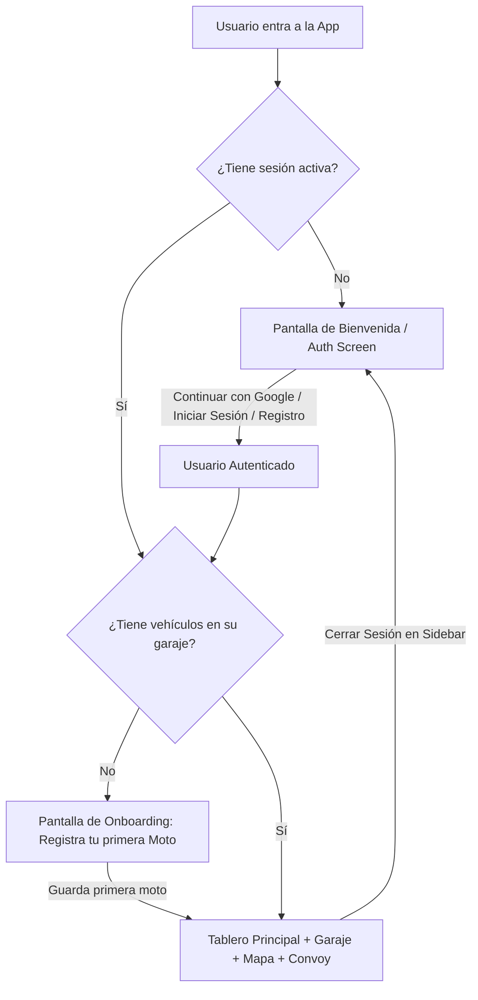

# 📋 PROMPT DE EJECUCIÓN: SPRINT 3 (Auth Gate & Onboarding Real)

> **⚠️ REGLA DE COMUNICACIÓN OBLIGATORIA:** Todas tus respuestas, explicaciones, reportes de entrega y comentarios deben ser redactados **estrictamente en Español**.

---

## 1. [Rol y Contexto para Claude]
Eres el **Lead Software Engineer & UI/UX Developer**. Tu objetivo es estructurar el **flujo de autenticación obligatorio (Auth Gate)** y el **Onboarding guiado** en la aplicación **Bike Tracker** (React + TypeScript + Tailwind CSS).

---

## 2. [Diagnóstico y Requerimiento de Producto]
Actualmente la aplicación muestra el Tablero, los vehículos demo (`Toyota MCP412`) y el Garaje incluso si el usuario no ha iniciado sesión. 

**Flujo Correcto que debes implementar:**


---

## 3. [Especificación Técnica Paso a Paso]

### Paso 1: Pantalla de Bienvenida & Auth Gate (`src/components/auth/WelcomeAuthScreen.tsx`)
- Crear `src/components/auth/WelcomeAuthScreen.tsx` que se renderice en `App.tsx` cuando `!user || !user.isLoggedIn`:
  - **Identidad Visual:** Logo e isotipo de **Bike Tracker**, ilustración/icono motero moderno y título: *"Tu compañero de ruta, telemetría y seguridad en convoy"*.
  - **Selector de Idioma:** Botones **ES / EN** en la esquina superior para traducir la pantalla de bienvenida.
  - **Botón Principal:** **`Continuar con Google`** (con icono de Google oficial, inicia sesión en 1 clic creando el perfil con avatar y nombre).
  - **Botón Secundario:** **`Crear Cuenta / Iniciar con Correo`** (abre el formulario manual con pestañas Iniciar Sesión / Registrarse, nombre, correo, contraseña y selección de avatar).
  - **Acceso Rápido Demo:** Enlace discreto en el pie: *"¿Quieres probar primero? Entrar en Modo Demo"* (inicia sesión con el usuario demo y los vehículos precargados).

### Paso 2: Flujo de Onboarding para Usuario Nuevo (`src/components/auth/OnboardingWizard.tsx`)
- Si el usuario está autenticado (`user.isLoggedIn === true`) pero su garaje está vacío (`vehicles.length === 0`):
  - No mostrar un Tablero vacío; mostrar el **Asistente de Bienvenida (OnboardingWizard)**:
    1. Saludo personalizado: *"¡Hola, [Nombre del Piloto]! 👋 Bienvenido a Bike Tracker"*.
    2. Explicación breve: *"Para unirte a rodadas y activar tu telemetría, registra tu primer vehículo."*
    3. Formulario integrado: Placa, Tipo de vehículo (🏍️ Moto / 🚗 Carro), Marca/Modelo (con botones rápidos de sugerencia: Yamaha, BMW, KTM, etc.), Fecha de vencimiento de SOAT y Tecnomecánica, y botón para adjuntar foto/documento digital.
    4. Botón: **`🚀 Guardar y Entrar al Tablero`**.
  - Al completar este paso, el vehículo se guarda, se establece como activo y el usuario entra directamente a la aplicación completa.

### Paso 3: Protección de Rutas en `App.tsx`
- Modificar `src/App.tsx`:
  ```tsx
  if (!user || !user.isLoggedIn) {
    return <WelcomeAuthScreen />
  }

  if (vehicles.length === 0) {
    return <OnboardingWizard />
  }

  return (
    // Renderizado del Tablero, Header, BottomNav, Sidebar, Mapa, Garaje, Convoy
  )
  ```

### Paso 4: Cierre de Sesión Limpio (`logout`)
- Al pulsar **"Cerrar Sesión"** en el `Sidebar.tsx`:
  - Limpiar la sesión en el estado y en `localStorage`.
  - La aplicación debe redirigir inmediatamente a `WelcomeAuthScreen`.

---

## 4. [Archivos y Rutas Afectadas]
- `src/components/auth/WelcomeAuthScreen.tsx` (Nuevo: Pantalla inicial de Auth y bienvenida).
- `src/components/auth/OnboardingWizard.tsx` (Nuevo: Wizard paso a paso para usuarios nuevos).
- `src/components/auth/AuthModal.tsx` (Refactorizado o integrado como modal emergente).
- `src/context/AppContext.tsx` (Asegurar que el estado inicial no fuerce vehículos demo si no hay sesión iniciada, y método `loginDemo`).
- `src/App.tsx` (Condición de Auth Gate: `!user.isLoggedIn` -> Welcome, `vehicles.length === 0` -> Onboarding, sino -> App completa).
- `src/utils/i18n.ts` (Agregar todas las claves de bienvenida, auth y onboarding en ES y EN).

---

## 5. [Criterios de Aceptación / Definition of Done (DoD)]
1. ✅ **Auth Gate Activo:** Al entrar a la app sin sesión (o tras cerrar sesión), el usuario ve la pantalla de Bienvenida/Login y NO ve el Tablero ni datos de vehículos.
2. ✅ **Google Sign-In & Login Manual:** El usuario puede autenticarse con Google en 1 clic o registrarse manualmente.
3. ✅ **Onboarding para Nuevos Usuarios:** Si un usuario recién registrado no tiene motos, es guiado a registrar su primera moto antes de entrar al Tablero.
4. ✅ **Persistencia:** Al recargar la página con sesión iniciada, el usuario permanece logueado con sus motos guardadas.
5. ✅ **Cierre de Sesión:** Al pulsar "Cerrar Sesión" en el menú lateral, la app regresa a la pantalla de bienvenida.
6. ✅ **Compilación Limpia:** `tsc --noEmit` y `npm run build` pasan con 0 errores.
7. ✅ **Respuesta en Español:** Todo el reporte y explicación final deben ser redactados en Español.
